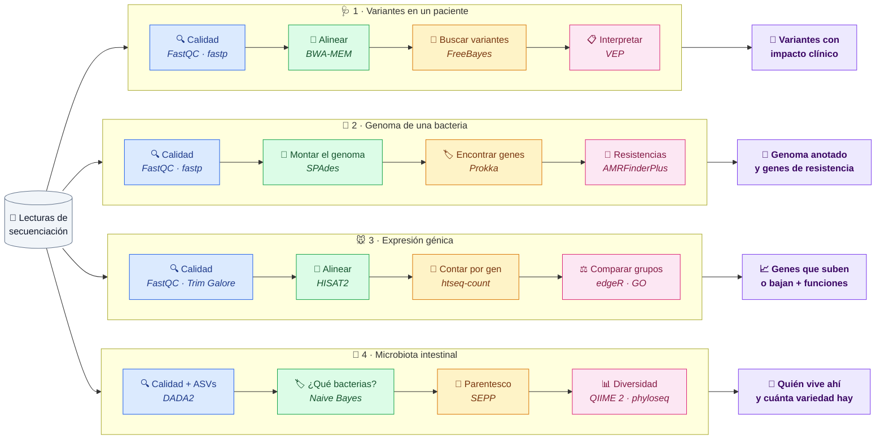
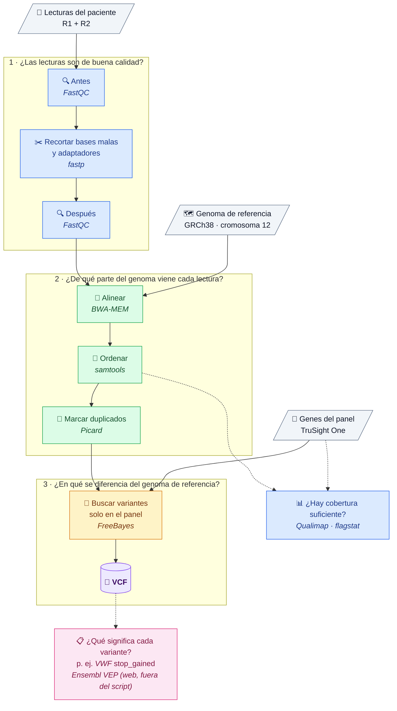
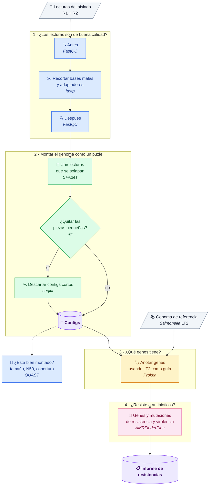
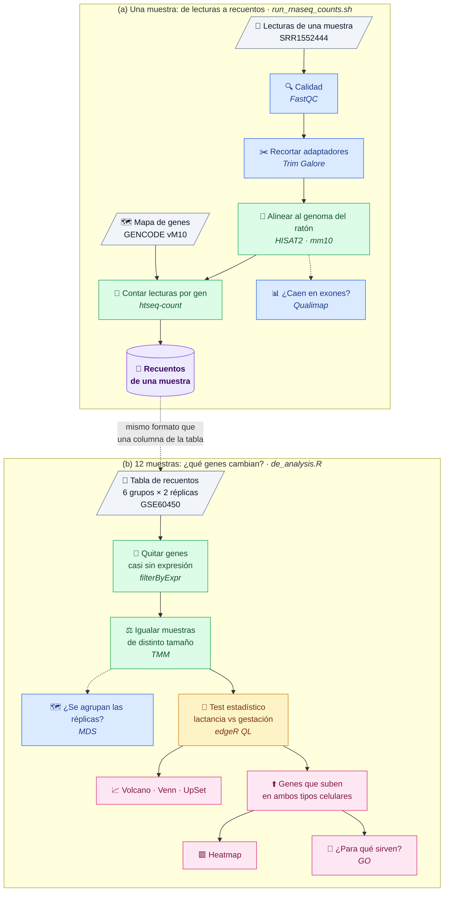
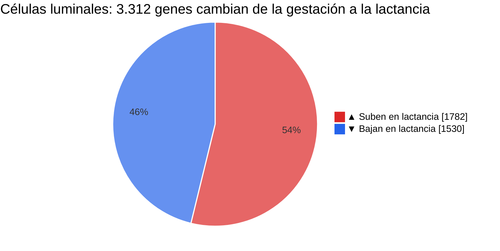
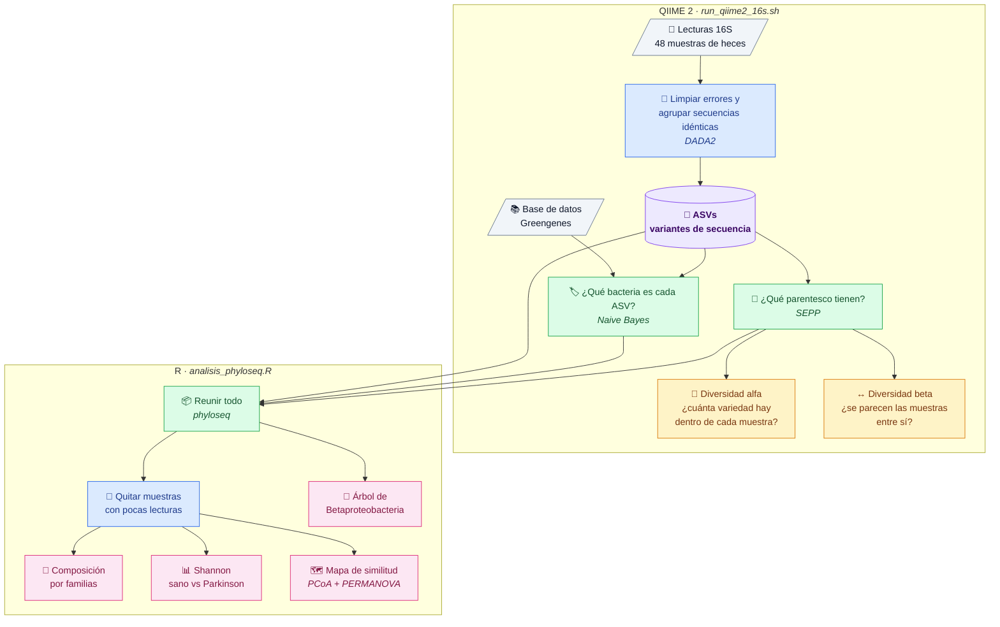
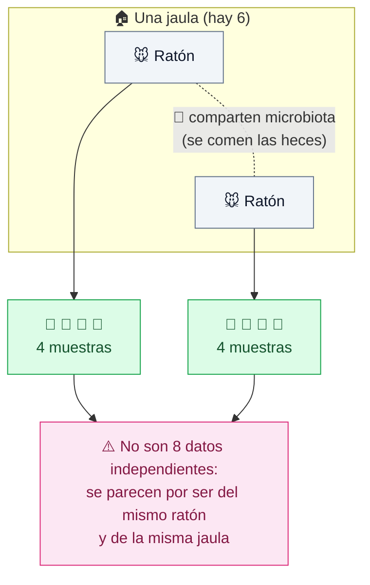

# Pipelines de análisis NGS


Colección de **cuatro pipelines reproducibles** para datos de secuenciación Illumina, que cubren los cuatro tipos de análisis NGS más habituales: variantes germinales en humano, genómica bacteriana, transcriptómica y metataxonómica.

Parten de las prácticas de las asignaturas *Secuenciación genómica y análisis de variantes*, *Análisis transcriptómicos de la expresión génica* y *Análisis de datos ómicos para poblaciones* del Máster en Bioinformática (VIU, 2025-2026). Las he reescrito como **scripts parametrizados**, con **entornos Conda** y con varias **correcciones metodológicas** respecto a la versión original (ver la sección *Cambios respecto a la práctica* de cada pipeline).

---

## Índice

- [Visión general](#visión-general)
- [Estructura del repositorio](#estructura-del-repositorio)
- [Instalación](#instalación)
- [Convenciones comunes](#convenciones-comunes)
- [1. Variantes en panel de captura](#1-variantes-en-panel-de-captura)
- [2. Genoma bacteriano](#2-genoma-bacteriano)
- [3. RNA-seq](#3-rna-seq-de-lecturas-a-genes-diferencialmente-expresados)
- [4. Metataxonómica 16S rRNA](#4-metataxonómica-16s-rrna)
- [Próximos pasos](#próximos-pasos)

---

## Visión general

Los cuatro pipelines comparten el mismo esqueleto: **control de calidad → procesado de lecturas → análisis principal → interpretación biológica**. Lo que cambia es la pregunta y, por tanto, las herramientas de cada etapa.



| Pipeline | Pregunta | Datos de la práctica | Lecturas | Salida principal |
|---|---|---|---|---|
| [`variantes-panel`](variantes-panel/) | ¿Qué variantes germinales tiene el paciente y cuáles son patogénicas? | Panel TruSight One, muestra NA12880 (Platinum Genomes), GRCh38 (chr12) | PE 2 × 151 pb | VCF (anotado después en VEP web) |
| [`genoma-bacteriano`](genoma-bacteriano/) | ¿Cómo es el genoma de este aislado y qué resistencias porta? | *S.* Typhimurium SAL4, aislado de queso, SRR18072959 (PRJNA802840) | PE | Ensamblaje, anotación y genes AMR |
| [`rnaseq`](rnaseq/) | ¿Qué genes cambian su expresión entre gestación y lactancia? | Glándula mamaria de ratón, GSE60450 (Fu et al., 2015) | SE 100 pb | Tablas de DEG, figuras y GO |
| [`metataxonomica-16s`](metataxonomica-16s/) | ¿Cambia la microbiota intestinal según el donante (sano / Parkinson)? | Tutorial *PD mice* de QIIME 2 (Sampson et al., 2016) | SE 150 pb (V4) | Tabla de ASVs, taxonomía y diversidad |

### Herramientas por etapa

| Etapa | variantes-panel | genoma-bacteriano | rnaseq | metataxonomica-16s |
|---|---|---|---|---|
| Calidad | FastQC | FastQC | FastQC | `demux summarize` |
| Limpieza | fastp | fastp | Trim Galore | DADA2 |
| Mapeo / ensamblaje | BWA-MEM + SAMtools | SPAdes | HISAT2 + SAMtools | — |
| QC del resultado | flagstat · Qualimap · Picard | QUAST | flagstat · Qualimap rnaseq | `denoising-stats` |
| Análisis principal | FreeBayes · RTG vcfstats | Prokka | htseq-count · edgeR | Naive Bayes · SEPP |
| Interpretación | Ensembl VEP (web) | AMRFinderPlus | GO (`goana`) | Diversidad alfa/beta · phyloseq · vegan |

---

## Estructura del repositorio

```text
ngs-pipelines/
├── envs/                          # Un entorno Conda por pipeline
│   ├── variantes-panel.yml
│   ├── genoma-bacteriano.yml
│   ├── rnaseq.yml
│   └── metataxonomica-R.yml       # (QIIME 2 usa su fichero oficial)
├── variantes-panel/
│   ├── get_reference.sh           # Descarga GRCh38 chr12
│   └── run_variantes_panel.sh     # Pipeline hasta el VCF (VEP se usa en la web)
├── genoma-bacteriano/
│   ├── get_data.sh                # Lecturas SRA + referencia LT2
│   └── run_genoma_bacteriano.sh
├── rnaseq/
│   ├── get_data.sh                # Lecturas, índice mm10, GTF y matriz GEO
│   ├── run_rnaseq_counts.sh       # FASTQ → recuentos (una muestra)
│   └── de_analysis.R              # Recuentos → DEG → GO (12 muestras)
└── metataxonomica-16s/
    ├── get_data.sh                # Datos del tutorial + clasificador + SEPP
    ├── run_qiime2_16s.sh          # QIIME 2: FASTQ → ASVs → diversidad
    └── analisis_phyloseq.R        # Estadística en R sobre la salida de QIIME 2
```

Cada carpeta sigue el mismo patrón: un script `get_*.sh` que descarga los datos públicos y un script `run_*` (más un `.R` cuando hay análisis estadístico) que ejecuta el pipeline.

---

## Instalación

Requisitos: Linux (o WSL), [Conda/Mamba](https://github.com/conda-forge/miniforge) y espacio en disco para las referencias.

```bash
git clone https://github.com/AndoniM12/ngs-pipelines.git && cd ngs-pipelines

conda env create -f envs/variantes-panel.yml
conda env create -f envs/genoma-bacteriano.yml
conda env create -f envs/rnaseq.yml
conda env create -f envs/metataxonomica-R.yml

# qiime2R no está en Bioconda: se instala desde GitHub dentro del entorno de R
conda activate metataxonomica-R
Rscript -e 'remotes::install_github("jbisanz/qiime2R")'

# QIIME 2 (2021.4) se instala con su fichero oficial
wget https://data.qiime2.org/distro/core/qiime2-2021.4-py38-linux-conda.yml
conda env create -n qiime2-2021.4 --file qiime2-2021.4-py38-linux-conda.yml
```

| Entorno | Pipeline | Herramientas principales |
|---|---|---|
| `variantes-panel` | 1 | fastqc, fastp, bwa, samtools, htslib, qualimap, picard, freebayes, rtg-tools |
| `genoma-bacteriano` | 2 | fastqc, fastp, spades, seqkit, quast, prokka, ncbi-amrfinderplus, sra-tools, ncbi-datasets-cli |
| `rnaseq` | 3 | fastqc, trim-galore, hisat2, samtools, qualimap, htseq, sra-tools, edgeR, limma, org.Mm.eg.db |
| `qiime2-2021.4` | 4 (parte QIIME 2) | QIIME 2 2021.4 (DADA2, feature-classifier, fragment-insertion, diversity) |
| `metataxonomica-R` | 4 (parte R) | phyloseq, microbiome, vegan, ggplot2, qiime2R |

---

## Convenciones comunes

Todos los scripts de Bash comparten el mismo diseño, para que pasar de uno a otro sea inmediato:

- **Opciones con `getopts`** y valores por defecto en la cabecera del script. `-h` (o una opción obligatoria ausente) muestra la ayuda.
  - `-s` nombre de la muestra · `-o` directorio de salida (`resultados` por defecto) · `-t` hilos (4 por defecto).
- **`set -euo pipefail`**: el script se detiene en el primer error, en lugar de seguir con ficheros vacíos.
- **Comprobación de las entradas** antes de empezar (`No existe: <fichero>`).
- **Salidas numeradas por paso** (`01_qc_raw/`, `02_trimming/`, …), en el mismo orden que el diagrama de cada pipeline.
- **Registro** con marca de tiempo en `<salida>/pipeline.log`, que se reinicia en cada ejecución.
- Los scripts de R escriben `sessionInfo.txt` para dejar constancia de las versiones de los paquetes.

```mermaid
flowchart LR
    A["⬇️ <b>get_*.sh</b><br/>descarga los datos"] --> B["⚙️ <b>run_*.sh</b><br/>ejecuta el pipeline"] --> C["📁 <b>resultados/</b><br/>una carpeta por paso"]
    C -. "solo RNA-seq y 16S" .-> D["📊 <b>*.R</b><br/>estadística"] --> E["🖼️ <b>resultados_*/</b><br/>figuras y tablas"]

    class A dato
    class B proc
    class C,E res
    class D ana
    classDef dato fill:#f1f5f9,stroke:#64748b,color:#0f172a
    classDef qc fill:#dbeafe,stroke:#2563eb,color:#1e3a8a
    classDef proc fill:#dcfce7,stroke:#16a34a,color:#14532d
    classDef ana fill:#fef3c7,stroke:#d97706,color:#78350f
    classDef inter fill:#fce7f3,stroke:#db2777,color:#831843
    classDef res fill:#ede9fe,stroke:#7c3aed,color:#3b0764,font-weight:bold
```



---

## 1. Variantes en panel de captura

**Objetivo:** identificar y anotar variantes germinales (SNVs e indels pequeños) en las regiones de un panel de captura clínico, y priorizar las patogénicas.

**Datos:** lecturas del panel TruSight One de la muestra NA12880, procedentes del material del máster (sin accesión pública). NA12880 pertenece al pedigrí CEPH 1463 secuenciado en Platinum Genomes: Eberle MA *et al.* (2017). A reference data set of 5.4 million phased human variants validated by genetic inheritance from sequencing a three-generation 17-member pedigree. *Genome Res* 27(1):157-164. [doi:10.1101/gr.210500.116](https://doi.org/10.1101/gr.210500.116)



### Uso

```bash
conda activate variantes-panel
cd variantes-panel && ./get_reference.sh
./run_variantes_panel.sh -1 NA12880_R1.fastq.gz -2 NA12880_R2.fastq.gz \
    -r ref/Homo_sapiens.GRCh38.dna.chromosome.12.fa \
    -b trusightone.hg38.bed -s NA12880 -t 4
```

> [!NOTE]
> Las lecturas de NA12880 y el BED del panel TruSight One proceden del material del máster y no se incluyen en el repositorio.

> [!IMPORTANT]
> **La anotación con VEP no la hace el script.** El pipeline termina en `05_variants/<muestra>.vcf.gz`. Ese VCF se sube a la [web de Ensembl VEP](https://www.ensembl.org/Tools/VEP) (*Homo sapiens*, GRCh38) y allí se anota y se filtra (p. ej. `SYMBOL = VWF` y `Consequence = stop_gained`). No hace falta instalar la caché de VEP en local.

| Opción | Descripción | Por defecto |
|---|---|---|
| `-1` / `-2` | FASTQ R1 / R2 (gz) | obligatorio |
| `-r` | Genoma de referencia (FASTA) | obligatorio |
| `-b` | Regiones de captura (BED) | obligatorio |
| `-s` | Nombre de la muestra (se usa como `SM` del read group) | obligatorio |
| `-C` | Lecturas mínimas con el alelo alternativo (FreeBayes) | `30` |
| `-o` / `-t` | Directorio de salida / hilos | `resultados` / `4` |

### Salidas

```text
resultados/
├── 01_qc_raw/      FastQC de las lecturas crudas
├── 02_trimming/    FASTQ limpios + informes fastp (html/json) y FastQC
├── 03_mapping/     <muestra>.sorted.bam, flagstat, panel.harmonized.bed, qualimap/
├── 04_dedup/       <muestra>.dedup.bam + métricas de duplicados
└── 05_variants/    <muestra>.vcf.gz (+ .tbi) y vcfstats.txt  → se sube a VEP web
```

Para revisar en IGV: `04_dedup/<muestra>.dedup.bam`, `05_variants/<muestra>.vcf.gz` y `03_mapping/panel.harmonized.bed`.

### Resultados de la práctica (cromosoma 12)

| Paso | Métrica | Valor |
|---|---|---|
| Lecturas crudas | Pares | 7.939.910 (2 × 32-151 pb) |
| fastp (Q28, ≥ 100 pb) | Lecturas que pasan los filtros | 97,3 % · duplicación 2,6 % |
| Qualimap (regiones del panel) | Cobertura media / MAPQ medio | 95,7× / 59,3 |
| FreeBayes (C = 30, regiones del panel) | Variantes / SNPs / Het:Hom | 2.311 / 1.601 / 17,24 |
| VEP (web) | Hallazgo | *VWF* stop_gained 12:6019487 G>A, patogénica en ClinVar (enfermedad de von Willebrand) |

> [!NOTE]
> Sin restringir la llamada al panel (FreeBayes sobre todo el cromosoma 12, sin `-t`) se obtienen unas 9.800 variantes, 6.530 SNPs y un Het:Hom de 3,5.

### Cambios respecto a la práctica

| Aspecto | Práctica original | Este pipeline | Por qué |
|---|---|---|---|
| Read groups | Añadidos después con Picard; ID = instrumento, SM ≠ muestra | `bwa mem -R` durante el mapeo; ID = flowcell.carril (de la cabecera FASTQ), SM = muestra | Read groups correctos desde el origen, necesarios para el marcado de duplicados y la llamada |
| Alineamientos secundarios | `bwa mem -a` | Sin `-a` | `-a` inflaba el mapeo global de `flagstat` (65,9 % frente a 22,5 % primario) y añadía ruido a la llamada |
| SAM → BAM | Ficheros SAM intermedios | Una sola tubería `bwa \| samtools sort` | Menos disco y menos pasos |
| BED del panel | Se editaba a mano | Copia armonizada (UCSC `chr12` → Ensembl `12`) limitada a los contigs de la referencia; `freebayes -t` | El BED original no se toca y la llamada se restringe al panel |
| Umbral `-C` | Fijo en 30 | Configurable | Ver nota |

> [!WARNING]
> Con C = 30, una variante real de *PAH* (chr12:102.840.474 T>C, VAF 42 %, ~17 lecturas alternativas) **no se llamó**. Un umbral fijo de lecturas alternativas penaliza las regiones con menos cobertura. En muestras germinales es más razonable un umbral bajo seguido de un filtrado posterior por calidad y profundidad.

---

## 2. Genoma bacteriano

**Objetivo:** ensamblar *de novo* el genoma de un aislado de *Salmonella* de origen alimentario, evaluar la calidad del ensamblaje, anotarlo y detectar genes y mutaciones de resistencia a antimicrobianos.

**Datos:** *Salmonella enterica* subsp. *enterica* serovar Typhimurium cepa SAL4, aislada de una muestra de queso en Michoacán (México) por la Universidad Michoacana de San Nicolás de Hidalgo. Illumina MiSeq, paired-end. BioProject [PRJNA802840](https://www.ncbi.nlm.nih.gov/bioproject/PRJNA802840), run SRR18072959 (sin publicación asociada).



### Uso

```bash
conda activate genoma-bacteriano
cd genoma-bacteriano && ./get_data.sh
./run_genoma_bacteriano.sh -1 data/SRR18072959_1.fastq.gz -2 data/SRR18072959_2.fastq.gz \
    -g data/LT2_genomic.gbk -s SRR18072959 -m 500 -t 8
```

| Opción | Descripción | Por defecto |
|---|---|---|
| `-1` / `-2` | FASTQ R1 / R2 (gz) | obligatorio |
| `-g` | Genoma de referencia anotado (GenBank) para Prokka | obligatorio |
| `-s` | Nombre de la muestra | obligatorio |
| `-m` | Longitud mínima de contig (0 = sin filtrar, como en la práctica) | `0` (recomendado `500`) |
| `-O` | Organismo para AMRFinderPlus | `Salmonella` |
| `-o` / `-t` | Directorio de salida / hilos | `resultados` / `4` |

### Salidas

```text
resultados/
├── 01_qc_raw/       FastQC de las lecturas crudas
├── 02_trimming/     FASTQ limpios + informes fastp y FastQC
├── 03_assembly/     spades/ y <muestra>.contigs.fasta (filtrado si -m > 0)
├── 04_quast/        report.txt / report.html
├── 05_annotation/   ref_prots.faa y prokka/ (.gff, .gbk, .faa, .fna, .tsv…)
└── 06_amr/          <muestra>.amrfinder.tsv y versión de la base de datos
```

### Resultados de la práctica (`-m 500 -t 8`)

| Paso | Métrica | Valor |
|---|---|---|
| fastp (Q25, ≥ 151 pb) | Lecturas que pasan los filtros | 97 % · duplicación 9,0 % |
| SPAdes (--careful) | k-meros / contigs | 21-127 / 4.047 |
| QUAST | N50 / L50 (scaffolds) | 137.003 pb / 12 |
| QUAST | Scaffolds > 10 kb | 30 scaffolds, 4,81 Mb |
| QUAST | Cobertura media | ~104× |
| Prokka (contigs ≥ 500 pb) | CDS / rRNA / tRNA | 6.587 / 15 / 92 |
| AMRFinderPlus (90/90) | Gen de resistencia | *emrD* |

### Cambios respecto a la práctica

- **Sintaxis de fastp corregida.** `--cut_front` y `--cut_tail` son opciones sin valor; el umbral se fija con `--cut_mean_quality`.
- **Filtrado opcional de contigs** (`-m 500`). Con 4.043 scaffolds, un N90 de 503 pb y un L90 de 2.299, la mayoría eran fragmentos cortos. Los 30 scaffolds de más de 10 kb ya suman 4,8 Mb, prácticamente el genoma completo. Con `-m 500` quedan 2.319 contigs (6,68 Mb) y Prokka anota 6.587 CDS.
- **AMRFinderPlus en modo combinado** (proteínas + nucleótidos + GFF), que detecta tanto genes como mutaciones puntuales y evita duplicados entre ambas búsquedas.

> [!NOTE]
> **¿Por qué *emrD*?** Con `--plus`, AMRFinderPlus devuelve 10 genes, pero solo *emrD* tiene `Element type` = `AMR`. Los otros 9 son de virulencia (`VIRULENCE`: *invA*, *spvD*, *sseK2*…) o de respuesta al estrés (`STRESS`: *asr*).

---

## 3. RNA-seq: de lecturas a genes diferencialmente expresados

**Objetivo:** cuantificar la expresión génica y encontrar los genes que cambian entre gestación y lactancia en células luminales y basales de la glándula mamaria de ratón.

**Datos:** Fu NY *et al.* (2015). EGF-mediated induction of Mcl-1 at the switch to lactation is essential for alveolar cell survival. *Nat Cell Biol* 17(4):365-375. [doi:10.1038/ncb3117](https://doi.org/10.1038/ncb3117) · GEO [GSE60450](https://www.ncbi.nlm.nih.gov/geo/query/acc.cgi?acc=GSE60450)

El pipeline tiene **dos partes independientes**:

- **(a) `run_rnaseq_counts.sh`** procesa una muestra desde el FASTQ hasta su tabla de recuentos. Se ejecuta una vez por muestra.
- **(b) `de_analysis.R`** hace la expresión diferencial sobre la **matriz de recuentos de las 12 muestras** publicada en GEO (generada por los autores con el mismo tipo de flujo).



Diseño experimental de la parte (b):

| | Virgen | Gestante | Lactante |
|---|---|---|---|
| **Basal** | DG, DH | DI, DJ | DK, DL |
| **Luminal** | LA, LB | LC, LD | LE, LF |

Contrastes: `luminal_lactate − luminal_pregnant` y `basal_lactate − basal_pregnant`. Un gen se considera DEG con **FDR ≤ 0,05 y |logFC| ≥ 1**.

### Uso

```bash
conda activate rnaseq
cd rnaseq && ./get_data.sh

# (a) Preprocesado de una muestra hasta la tabla de recuentos
./run_rnaseq_counts.sh -r data/SRR1552444.fastq.gz -x data/mm10/genome \
    -g data/gencode.vM10.annotation.gtf -s SRR1552444 -t 4

# (b) Expresión diferencial sobre la matriz de recuentos de las 12 muestras
Rscript de_analysis.R data/GSE60450_Lactation-GenewiseCounts.txt.gz resultados_de
```

| Opción (a) | Descripción | Por defecto |
|---|---|---|
| `-r` | FASTQ single-end (gz) | obligatorio |
| `-x` | Prefijo del índice de HISAT2 | obligatorio |
| `-g` | Anotación GTF | obligatorio |
| `-s` | Nombre de la muestra | obligatorio |
| `-k` | Alineamientos por lectura en HISAT2 | `1` |
| `-S` | Hebra para htseq-count (`no` · `yes` · `reverse`) | `no` (TruSeq RNA v2, sin hebra) |
| `-o` / `-t` | Directorio de salida / hilos | `resultados` / `4` |

### Salidas

```text
resultados/                         (a)
├── 01_qc_raw/      FastQC
├── 02_trimming/    FASTQ recortado + informe de Trim Galore y FastQC
├── 03_alignment/   <muestra>.sorted.bam, hisat2.log, flags.txt, mapq.txt, flagstat, qualimap/
└── 04_counts/      <muestra>.counts.tsv y assignment_summary.tsv

resultados_de/                      (b)
├── figuras/        01 gen máximo · 02 genes detectados · 03-04 logCPM antes/después de TMM
│                   05 MDS · 06 BCV · 07 dispersión QL · 08 volcanos · 09 Venn · 10 UpSet · 11 heatmap
├── tablas/         muestras, factores de normalización, DE_<contraste>.tsv, GO_BP/MF…
└── sessionInfo.txt
```

### Resultados de la práctica

La parte (b) se ha ejecutado con R 4.5.3, edgeR 4.10.7 y limma 3.68.5.

| Paso | Métrica | Valor |
|---|---|---|
| Lecturas (SRR1552444, SE 100 pb) | Crudas / tras Trim Galore | 27.919.481 / 27.904.493 |
| HISAT2 (-k 1) | Lecturas alineadas | 97,1 % |
| Qualimap rnaseq | Lecturas exónicas / sesgo 5'-3' | 84,7 % / 1,23 |
| htseq-count | Lecturas asignadas a genes | 73,4 % (too_low_aQual 11,7 %) |
| filterByExpr | Genes conservados | 15.969 de 27.179 (58,8 %) |
| TMM | norm.factors < 1 | LD, LE, LF (luminales gestante y lactantes) |
| QL F-test luminal lactante vs gestante | DEG (FDR ≤ 0,05, \|logFC\| ≥ 1) | 3.312 (1.782 up, 1.530 down) |
| Genes up en lactancia (luminal y basal) | n / GO BP principal | 114 / biosíntesis de colesterol y esteroles |



### Cambios y notas de interpretación

- **`too_low_aQual` no son lecturas de baja calidad.** HISAT2 asigna MAPQ 0 o 1 a las lecturas multimapeadas (~4,1 millones en esta muestra) y htseq-count descarta por defecto las que tienen MAPQ < 10. Ese 11,7 % corresponde a lecturas con más de una localización posible (regiones repetitivas o genes parálogos).
- **HISAT2 `-k 5` no da cinco alineamientos primarios.** Da uno primario y hasta cuatro secundarios (FLAG 256). Con `-k 1` se pierde la información de que la lectura es ambigua, aunque el MAPQ bajo la sigue reflejando.
- **Interpretación de los coeficientes del GLM.** Son log-abundancias relativas, no recuentos. Que *Xkr4* tenga el mismo valor (−19,03) en los tres grupos luminales indica cero recuentos: es el límite inferior del modelo, no un valor de expresión real.
- **Composición de las librerías.** Los norm.factors < 1 de las muestras luminales gestante y lactantes se deben a que unos pocos genes muy expresados (caseínas como *Csn1s2a*) acaparan una parte importante de las lecturas. TMM corrige ese sesgo de composición.
- **El volcano plot muestra −log10(FDR)**, no log10.
- **Identificadores de gen distintos en (a) y (b).** `run_rnaseq_counts.sh` cuenta con htseq-count sobre el GTF de GENCODE, así que la tabla usa IDs de Ensembl con versión (`ENSMUSG00000000001.4`). La matriz de GEO la generaron los autores con featureCounts y la anotación integrada de mm10 (RefSeq), indexada por Entrez Gene ID. Para llevar la tabla de (a) a Entrez se quitan las filas `__*` de htseq-count y la versión del ID, y se mapea con `org.Mm.eg.db`:

  ```r
  cs <- read.delim("resultados/04_counts/SRR1552444.counts.tsv", header = FALSE,
                   col.names = c("gene_id", "counts"))
  cs <- cs[!startsWith(cs$gene_id, "__"), ]
  cs$entrez <- mapIds(org.Mm.eg.db, keys = sub("\\.\\d+$", "", cs$gene_id),
                      keytype = "ENSEMBL", column = "ENTREZID", multiVals = "first")
  by_entrez <- tapply(cs$counts, cs$entrez, sum)   # descarta los NA y suma duplicados
  ```

  La equivalencia no es 1:1: muchos genes de GENCODE (lncRNA, pseudogenes) no tienen Entrez y varios Ensembl pueden caer en el mismo Entrez. Aun con los mismos IDs, los recuentos no coinciden exactamente con la columna de GEO porque cambian la anotación, el alineador y el contador. Con SRR1552444 quedan 18.134 de 48.440 genes Ensembl sin Entrez y se recuperan 23.293 de los 27.179 genes de GEO. La correlación (log2) más alta es con MCL1-LA (r = 0,983; 0,977 con su réplica LB), lo que confirma que SRR1552444 es esa muestra.

> [!NOTE]
> Filtrar *a posteriori* por |logFC| ≥ 1 sobre el test QL es lo que pedía la práctica. El enfoque más riguroso es contrastar directamente frente a ese umbral con `glmTreat`.

---

## 4. Metataxonómica 16S rRNA

**Objetivo:** describir la composición y la diversidad de la microbiota intestinal de ratones (wild type y susceptibles, ASO) que recibieron un trasplante fecal de donantes sanos o con Parkinson.

**Datos:** tutorial [*Parkinson's Mouse*](https://docs.qiime2.org/2021.4/tutorials/pd-mice/) de QIIME 2 (versión 2021.4), basado en Sampson TR *et al.* (2016). Gut Microbiota Regulate Motor Deficits and Neuroinflammation in a Model of Parkinson's Disease. *Cell* 167(6):1469-1480.e12. [doi:10.1016/j.cell.2016.11.018](https://doi.org/10.1016/j.cell.2016.11.018)

El análisis se divide entre **QIIME 2** (de las lecturas a las métricas de diversidad) y **R** (estadística y figuras con phyloseq), cada uno en su propio entorno.



### Uso

```bash
cd metataxonomica-16s && ./get_data.sh

conda activate qiime2-2021.4
./run_qiime2_16s.sh -m data/manifest.tsv -d data/sample_metadata.tsv \
    -c data/gg-13-8-99-515-806-nb-classifier.qza -r data/sepp-refs-gg-13-8.qza -t 4

conda activate metataxonomica-R
Rscript analisis_phyloseq.R resultados data/sample_metadata.tsv resultados_R
```

| Opción | Descripción | Por defecto |
|---|---|---|
| `-m` | Manifest (`SingleEndFastqManifestPhred33V2`) | obligatorio |
| `-d` | Metadatos de las muestras | obligatorio |
| `-c` | Clasificador taxonómico (`.qza`) | obligatorio |
| `-r` | Referencias SEPP (`.qza`) | obligatorio |
| `-L` | Longitud de truncado de DADA2 (revisar en `demux_seqs.qzv`) | `150` |
| `-D` | Profundidad de rarefacción para `core-metrics` | `2000` |
| `-M` | Profundidad máxima de la curva de rarefacción | `4000` |
| `-g` | Columna de metadatos para comparar grupos | `donor_status` |
| `-o` / `-t` | Directorio de salida / hilos | `resultados` / `4` |

### Salidas

```text
resultados/                       (QIIME 2; los .qzv se abren en https://view.qiime2.org)
├── 01_import/       demux_seqs.qza/.qzv, metadata.qzv
├── 02_dada2/        table.qza, rep_seqs.qza, denoising_stats.qzv
├── 03_taxonomy/     taxonomy.qza/.qzv, taxa_barplot.qzv
├── 04_phylogeny/    tree.qza, tree_placements.qza
├── 05_diversity/    alpha_rarefaction.qzv, core_metrics/ (+ tests de grupo y PERMANOVA)
└── 06_export/       ASV.tsv, taxonomy.tsv, tree.nwk

resultados_R/                     (R)
├── 01_familias_abundancia_relativa.png
├── 02_shannon_por_grupo.png
├── 03_PCoA_bray.png · 03_PCoA_wunifrac.png
├── 04_arbol_Betaproteobacteria.png
├── profundidad_por_muestra.tsv · diversidad_alfa.tsv · PERMANOVA_*.txt
└── sessionInfo.txt
```

### Resultados de la práctica

| Paso | Métrica | Valor |
|---|---|---|
| Diseño | Muestras / jaulas | 48 muestras, 6 jaulas; 4 grupos genotipo × donante |
| DADA2 | Muestra problemática | recip.460.WT.HC3.D49: 16.327 lecturas → 9.919 tras el filtrado → 347 tras la eliminación de ruido (2,1 %) |
| Taxonomía (nivel 5) | Familias más abundantes | Bacteroidaceae, Lachnospiraceae, Porphyromonadaceae |
| Rarefacción | Jaula con mayor diversidad | C31 (Shannon) |
| phyloseq | ASVs / Clostridiales | 287 / 156 |
| Shannon (media) | Donante sano / Parkinson | 2,90 / 2,54 |
| Árbol Betaproteobacteria | Hallazgo | *Sutterella* (Alcaligenaceae) predominante; Comamonadaceae y Rhodocyclaceae en receptores de donante PD |

### Cambios respecto a la práctica

- **Contraste estadístico de la diversidad alfa.** En la práctica solo comparé medias de Shannon. Ahora se hace un test de Wilcoxon a dos niveles: por muestra y por ratón (media por animal).
- **Filtrado de muestras con poca profundidad.** recip.460.WT.HC3.D49 se queda en 347 lecturas: se excluye de los contrastes y de `core-metrics` (rarefacción a 2.000) en lugar de interpretarla.
- **Abundancias relativas.** La composición por familia se representa en proporciones (12 familias principales); con recuentos absolutos la comparación entre muestras de distinta profundidad no tiene sentido.
- **Diversidad beta**, que la práctica no incluía: PCoA con Bray-Curtis y UniFrac ponderado, y PERMANOVA (`adonis2`) con donante y genotipo.

> [!WARNING]
> **Pseudorreplicación y efecto jaula.** Hay 4 muestras por ratón y los ratones comparten jaula, así que tratar cada muestra como independiente infla la significación (por eso el contraste por ratón, y por eso los p-valores de PERMANOVA son orientativos). Además, los ratones son coprófagos y comparten microbiota dentro de cada jaula: las diferencias entre jaulas pueden reflejar la jaula y no el tratamiento. Lo más correcto sería un modelo mixto con el ratón (y la jaula) como efecto aleatorio.



---

## Próximos pasos

- [ ] Migrar los cuatro pipelines a **Nextflow DSL2**, con perfiles para Conda y Docker.
- [ ] Añadir **MultiQC** para agrupar los informes de calidad (FastQC, fastp, Qualimap, QUAST, HISAT2, htseq-count).
- [ ] RNA-seq: procesar las 12 muestras con la parte (a) y construir la matriz de recuentos propia, en lugar de usar la de GEO.
- [ ] RNA-seq: sustituir el filtrado *a posteriori* por logFC por `glmTreat`.
- [ ] 16S: modelo mixto (ratón y jaula como efectos aleatorios) para la diversidad alfa.

---

<sub>Autor: Andoni Moreno Lanceta · Máster en Bioinformática (VIU, 2025-2026)</sub>
